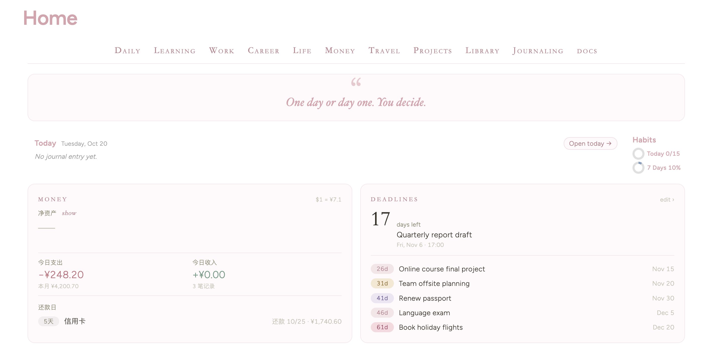
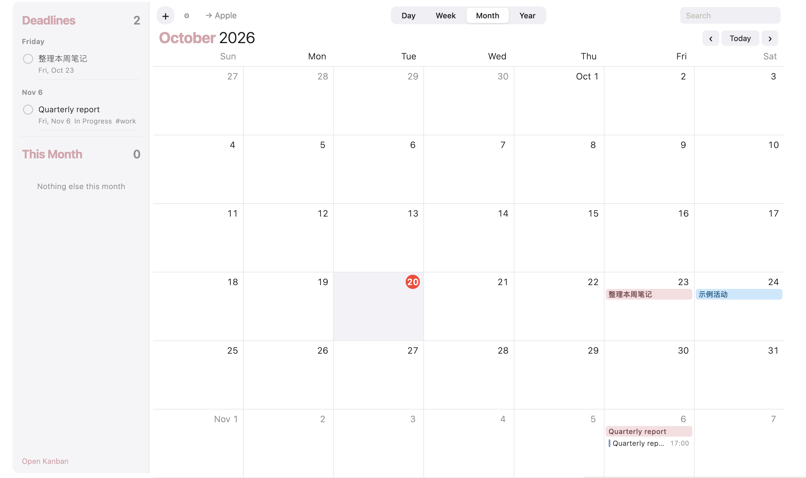
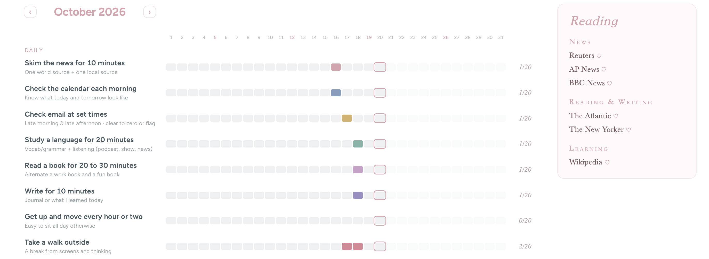
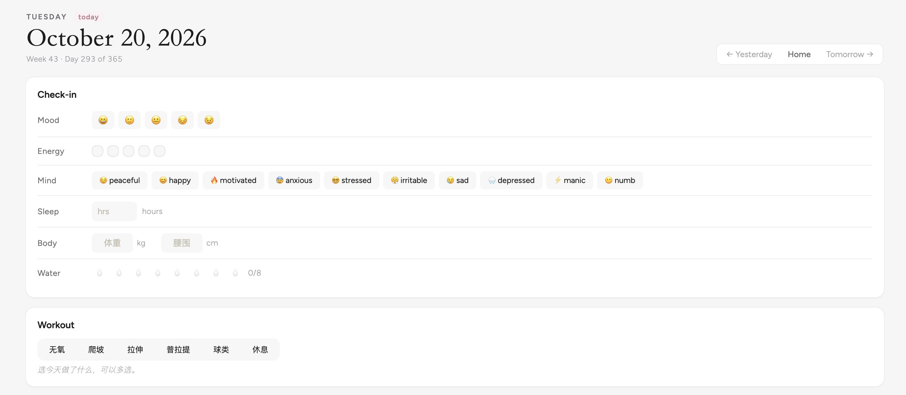
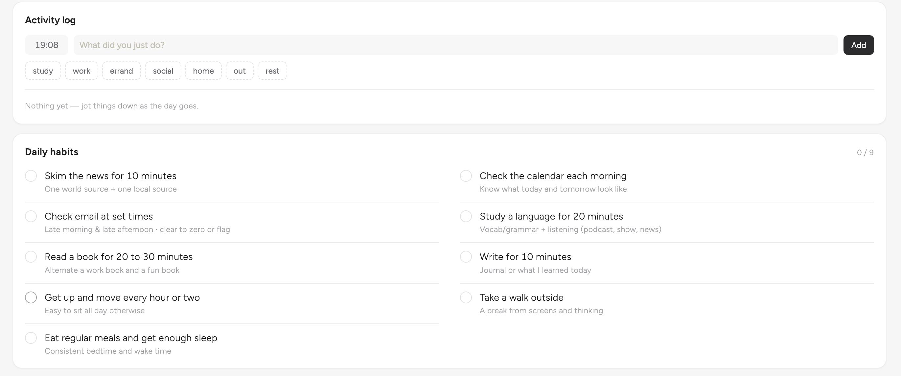
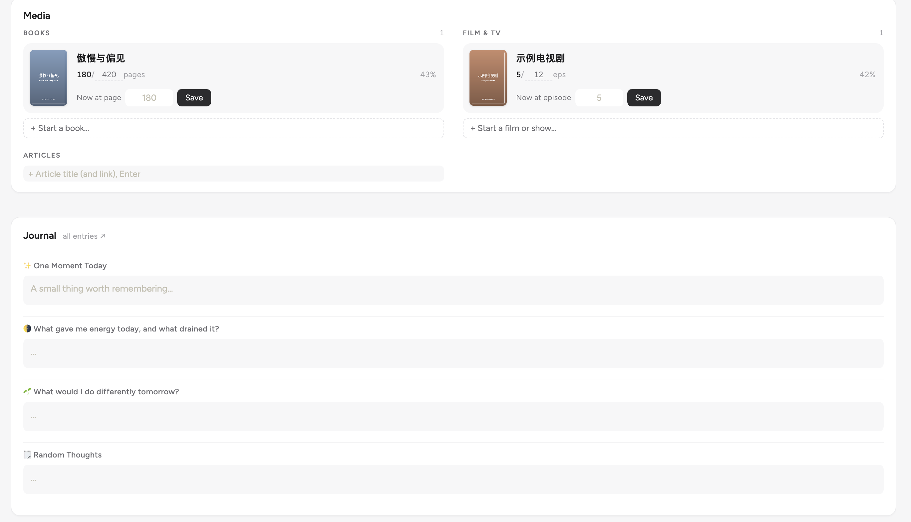
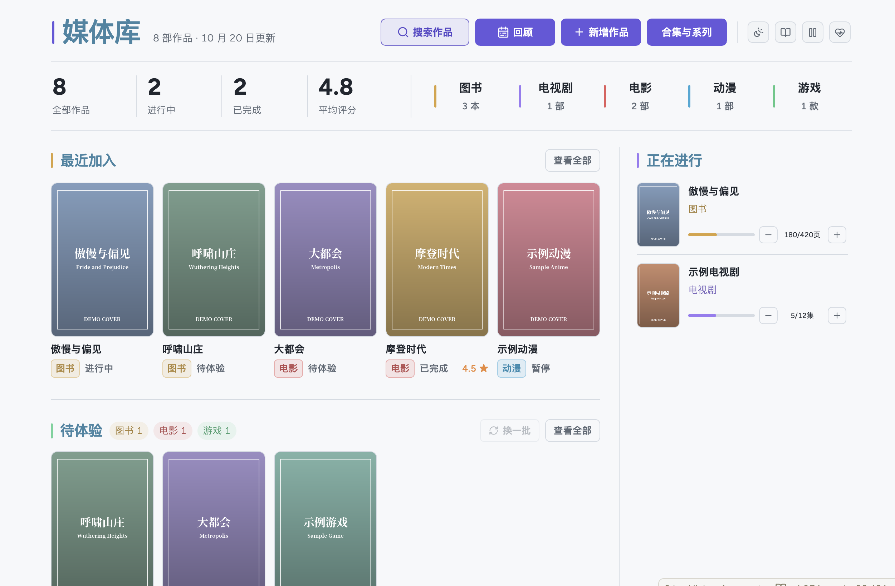
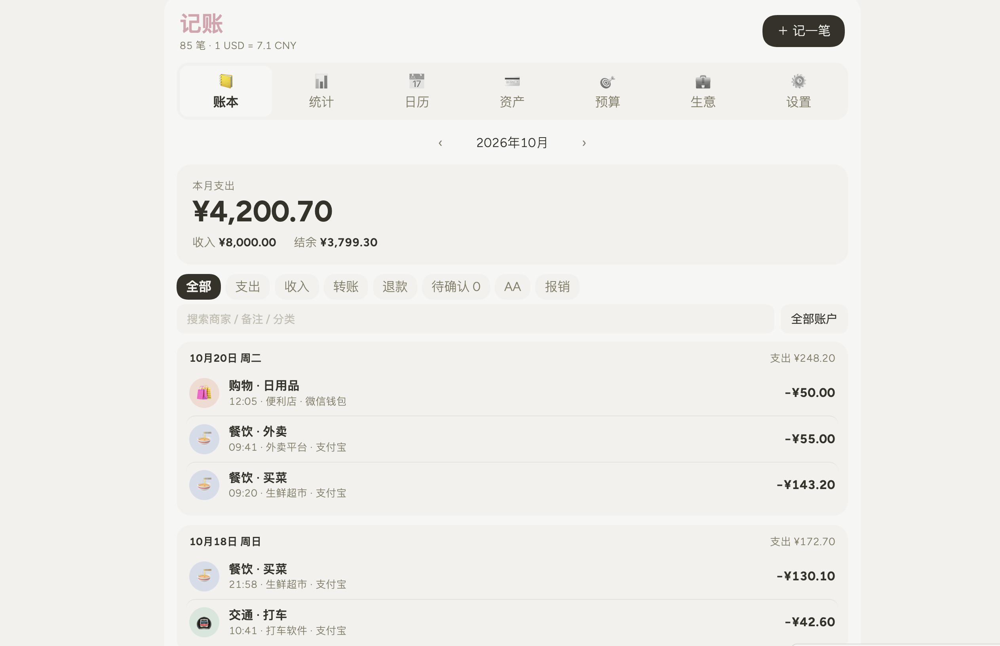

# Obsidian Dear Diary · 生活仪表盘

一套基于 Obsidian + DataviewJS 的个人生活系统：**首页仪表盘、每日页面、媒体库、个人记账**。所有数据都是普通的 Markdown 文件，存在你自己的电脑上。

A personal life dashboard for Obsidian built with DataviewJS: **Home dashboard, Daily page, Media library and Personal expense tracker**. Everything is plain Markdown that lives on your own machine.

> 仓库里的日记、账单、作品和日期全部是虚构的示例数据，可以放心删除。
> All diary entries, transactions, works and dates in this repo are fictional sample data.

---

## 截图 · Screenshots

### 首页 Home




### 每日 Daily




### 媒体库 Media library


### 记账 Personal expense


---

## 功能 · Features

### 🏠 首页 Home — `00 Home/Home.md`
- **导航栏**：自动读取顶层文件夹，悬停显示子文件夹和最近笔记；点 Daily / Money / Library 直接打开对应页面
- **每日一句**：从 `Insight List.md` 随机抽一句
- **Today 卡片**：一键打开（或新建）今天的每日页面，附 7 天习惯环形图
- **资金快照**：净资产、今日收支、信用账户还款日提醒
- **Deadlines 倒计时**：读取 `Deadlines.md`，过期自动隐藏
- **日历**：界面灵感来自 macOS 日历，日 / 周 / 月 / 年视图，可拖拽建活动；支持订阅 iCloud 公开日历（只读）、Kanban 截止日、`Important Dates.md` 里的生日纪念日
- **月度习惯追踪** 和 **阅读源** 面板

- **Nav bar** built from your top-level folders, with hover menus of subfolders and recent notes
- **Random quote** from `Insight List.md`
- **Today card** that opens (or creates) today's daily page, plus 7-day habit rings
- **Money snapshot**: net worth, today's spending/income, credit-card due dates
- **Deadline countdowns** from `Deadlines.md`
- **Calendar** inspired by macOS Calendar (day/week/month/year, drag to create/move), with optional read-only iCloud feeds, Kanban due dates and yearly important dates
- **Monthly habit tracker** and **reading sources** panel

### 📅 每日页面 Daily — `01 Daily/YYYY-MM-DD.md`
- 心情、精力、睡眠、饮水打卡；三餐记录；体重 / 腰围
- 训练记录：无氧（按部位轮换、记录组数重量、显示上次成绩）、爬坡、拉伸、普拉提、球类
- 活动时间线（汇总到 `00 Home/Activity Log.md`）
- 每日 / 每周习惯清单（模板里自己改）
- 媒体进度：直接给正在看的书或剧 +进度，同步回媒体库
- 日记框：问答式日记，自动存到 `90 Journaling/`，`Journal.md` 可按月浏览和搜索

- Mood, energy, sleep, water check-in; meals; body measurements
- Workout log (strength with split rotation and last-session hints, incline walk, stretch, pilates, court sports)
- Activity timeline (archived in `Activity Log.md`)
- Daily & weekly habit checklist (edit it in the template)
- Log media progress straight into the media library
- Journal box with prompts, saved to `90 Journaling/`

### 🎬 媒体库 Media library — `80 Library/媒体库/首页.md`
图书、电影、电视剧、动漫、游戏统一管理；状态、评分、进度、合集、多次体验记录、回顾统计、数据健康检查；支持豆瓣导入。详细说明见 `80 Library/媒体库/说明/使用说明.md`。

Books, films, TV, anime and games in one place, with status, rating, progress, collections, repeat-experience records, yearly review, data health checks and Douban import. See `80 Library/媒体库/说明/使用说明.md`.

> 媒体库基于 [obsidian-media-library-template](https://github.com/JackyGaoym/obsidian-media-library-template)（MIT）修改，详见 [THIRD_PARTY.md](THIRD_PARTY.md)。
> The media library is adapted from obsidian-media-library-template (MIT); see THIRD_PARTY.md.

### 💰 个人记账 Personal expense — `50 Money/Personal/Personal Expense.md`
界面灵感来自记账 app iCost。 · UI inspired by the iCost app.

- 多账户（资金 / 信用），支持人民币和美元，汇率每天自动更新
- 支出 / 收入 / 转账 / 退款，分类和子分类可自定义（`记账设置.md`）
- 月度统计图表、预算、周期记账
- 每笔账是 `Transactions/YYYY-MM/` 下的一条 Markdown 笔记

- Multiple accounts (cash / credit), CNY + USD with daily auto exchange rate
- Expense / income / transfer / refund, custom categories in `记账设置.md`
- Monthly charts, budgets, recurring entries
- Every transaction is a Markdown note under `Transactions/YYYY-MM/`

---

## 安装 · Installation

1. **下载**：点 `Code → Download ZIP` 解压，或 `git clone`。
   Download the ZIP (or clone) and unzip it.
2. **用 Obsidian 打开整个文件夹**：`打开其他仓库 → 打开本地仓库`（需要桌面版 Obsidian 1.9+，因为用到了 Bases）。
   Open the whole folder as a vault in desktop Obsidian 1.9+ (Bases is used).
3. **开启第三方插件**：`设置 → 第三方插件 → 关闭安全模式`，然后安装并启用下面的插件。
   Turn off Restricted mode and install the plugins below.
4. **Dataview 设置里打开 `Enable JavaScript Queries`**（必须）。
   In Dataview settings, enable **JavaScript Queries** (required).
5. **主题和 CSS 片段**：安装推荐主题；下载 MCL 片段放进 `.obsidian/snippets/`；在 `设置 → 外观 → CSS 代码片段` 中启用全部片段。
   Install the theme, add the MCL snippets to `.obsidian/snippets/`, then enable all snippets under Appearance.
6. 重启 Obsidian（或命令面板 `Reload app without saving`），首页会自动打开。
   Reload Obsidian; Home opens automatically.

### 插件 · Plugins

| 插件 Plugin | 用途 Used for | 必需 Required |
|---|---|---|
| [Dataview](https://github.com/blacksmithgu/obsidian-dataview) | 所有页面的渲染 · renders every page | ✅ |
| [Meta Bind](https://github.com/mProjectsCode/obsidian-meta-bind-plugin) | 媒体库状态 / 收藏控件 · media controls | ✅ |
| [QuickAdd](https://github.com/chhoumann/quickadd) | 媒体库新增作品 · add works | ✅ |
| [Homepage](https://github.com/mirnovov/obsidian-homepage) | 启动时打开首页 · open Home on startup | 推荐 recommended |
| [Kanban](https://github.com/mgmeyers/obsidian-kanban) | 首页日历读取的看板 · board read by the calendar | 推荐 recommended |
| [Douban](https://github.com/Wanxp/obsidian-douban) | 从豆瓣导入作品 · Douban import | 可选 optional |
| [Templater](https://github.com/SilentVoid13/Templater) | 可选的模板增强 · optional | 可选 optional |

### 外观 · Appearance

- 主题 Theme：**Dayspring**（截图所用）；媒体库在 **Border** 主题下也很好看。
- CSS 片段 Snippets（已包含 included）：`daily-rose`, `home-minimal`, `custom-callout`, `media-library`
- CSS 片段 Snippets（需自行下载 download separately）：`MCL Multi Column.css`、`MCL Wide Views.css`，来自 [Modular CSS Layout](https://github.com/efemkay/obsidian-modular-css-layout)，提供 `wide-page` 宽页面布局。

---

## 文件夹结构 · Folder structure

```
00 Home/            首页、Deadlines、Important Dates、Insight List、Kanban、日历活动
01 Daily/           每日页面（YYYY-MM-DD.md）
02 Inbox/           新笔记默认位置（不显示在导航栏）
10 Learning/        ┐
20 Work/            │
30 Career/          │  空文件夹，按自己需要使用
40 Life/            │  Empty — use them however you like
60 Travel/          │
70 Projects/        ┘
50 Money/Personal/  记账：Accounts/、Transactions/、记账设置.md
80 Library/         媒体库 + Reading Sources
90 Journaling/      日记框写入的日记
System & Attachments/
  Scripts/          所有 DataviewJS 脚本
  Templates/        Dear Diary.md 每日模板
```

导航栏会自动显示所有顶层文件夹（`00 Home`、`02 Inbox`、`System & Attachments`、`docs` 除外），新建或改名文件夹都会自动更新。
The nav bar lists every top-level folder automatically (except `00 Home`, `02 Inbox`, `System & Attachments` and `docs`).

---

## 自定义 · Customising

- **习惯**：改 `System & Attachments/Templates/Dear Diary.md` 里的 `#habit/xxx` 清单；说明文字和每周目标在 `Scripts/home-habits.js` 顶部的 `INFO`。
  Habits live in the Dear Diary template; descriptions and weekly targets are in `INFO` at the top of `home-habits.js`.
- **Deadlines / 重要日期 / 每日一句**：直接编辑 `00 Home/` 下对应的笔记，格式写在每个文件开头。
- **iCloud 日历**：首页日历右上角设置里粘贴公开日历链接（只读）。链接会存进 `System & Attachments/calendar-config.json` —— **公开分享你的仓库前记得清空它**。
  Paste a public iCloud calendar link in the calendar settings. It is saved to `calendar-config.json` — **clear it before sharing your vault**.
- **记账分类和账户**：在记账页的「设置」里改，或编辑 `记账设置.md`、`Accounts/` 下的账户笔记。
- **删除示例数据**：删掉 `01 Daily/`、`90 Journaling/` 的示例日期笔记，`50 Money/Personal/Transactions/` 和 `Accounts/` 下的示例，`80 Library/媒体库/作品/` 和 `记录/` 下的示例作品即可。

> ⚠️ 隐私提醒 Privacy：如果你 fork 后同步自己的数据到公开仓库，请注意 `.obsidian/plugins/obsidian-douban-plugin/data.json` 会保存豆瓣登录 Cookie，`calendar-config.json` 会保存日历链接。
> If you publish your own fork, note that the Douban plugin stores your login cookie in its `data.json`, and the calendar config stores your calendar links.

---

## 许可 · License

本项目采用 [CC BY-NC 4.0](https://creativecommons.org/licenses/by-nc/4.0/) 许可：可以免费使用、修改和分享，**需署名，禁止商业用途**（包括转售本模板）。第三方部分保留其原有许可，见 [THIRD_PARTY.md](THIRD_PARTY.md)。

Licensed under [CC BY-NC 4.0](https://creativecommons.org/licenses/by-nc/4.0/): free to use, adapt and share with attribution, **not for commercial use** (including reselling this template). Third-party parts keep their own licenses — see THIRD_PARTY.md.

示例封面为自动生成的占位图。请勿向公开仓库提交无权再分发的海报、剧照或书封。
Sample covers are generated placeholders. Don't commit posters or cover art you don't have rights to redistribute.

## 免责声明 · Disclaimer

本项目是独立的个人作品，与 Apple Inc.、iCost 及其开发者没有任何关联，也未获得其认可或赞助。Apple、macOS、iCloud、iCost 等名称和商标归各自所有者所有，仅用于描述功能和设计灵感。

This is an independent personal project and is not affiliated with, endorsed by or sponsored by Apple Inc. or iCost. Apple, macOS, iCloud, iCost and other names and trademarks belong to their respective owners and are used only to describe features and design inspiration.

---

Built with the help of [Claude](https://claude.ai).
